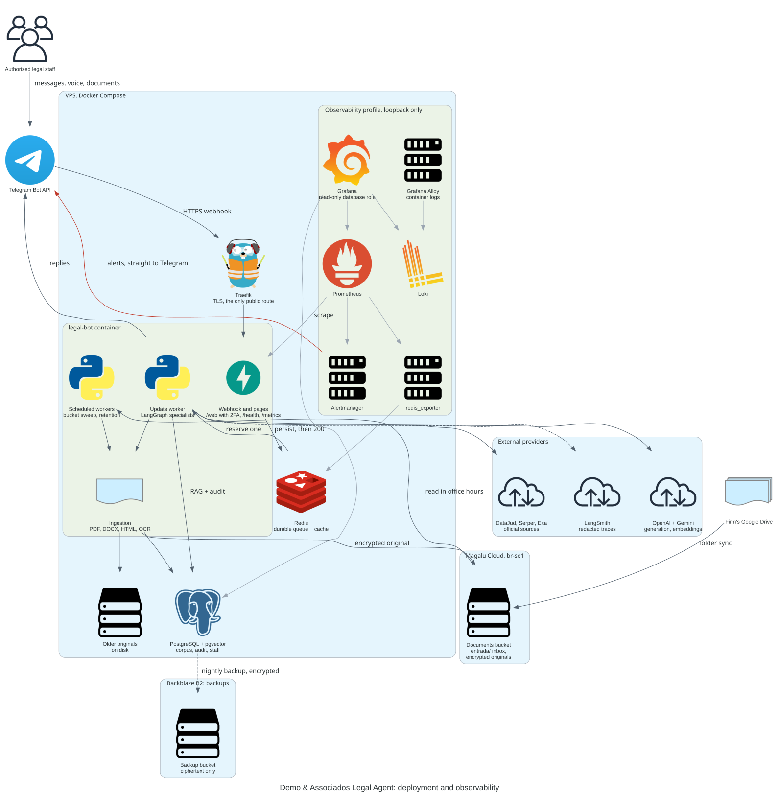

# Demo & Associados Legal Assistant

Internal Telegram legal assistant built with FastAPI, LangGraph,
PostgreSQL/pgvector RAG, Redis queues, OCR, and Docker Compose.

Source code, infrastructure, logs, and operator documentation are written in
English. Prompts and messages shown to the firm's staff remain in Brazilian
Portuguese.

## Production architecture

A message arrives, is persisted before it is answered, and is served by a worker
that reserves one update at a time. The full deployment, with observability, the
document intake and the external providers:



It is explained in [`docs/architecture/README.md`](docs/architecture/README.md),
and the executable graph is generated from the compiled LangGraph into
[`docs/architecture/agent-flow.md`](docs/architecture/agent-flow.md). The picture
is drawn by `scripts/render_architecture.sh` in a throwaway container and never
in CI, and the test suite checks, with no renderer installed, that it still
shows every service that runs.

```text
Telegram → HTTPS reverse proxy → FastAPI webhook and worker
                                      ├─ Redis: durable queue and cache
                                      ├─ PostgreSQL + pgvector: corpus and audit log
                                      └─ document ingestion: pypdf/OCR → embeddings → pgvector
```

The webhook stores every Telegram update in Redis before returning `HTTP 200`.
The application worker processes the queue during office hours and drains
out-of-hours messages first. After three failed attempts, an update moves to
`legal:queue:dead-letter`.

Documents are downloaded and processed inside the worker. Extracted text and
embeddings are stored in PostgreSQL; the original upload is retained in the
private `document_storage` Docker volume, referenced by a raw-file SHA-256.
Digital PDFs use `pypdf`, while scanned PDFs and images use Portuguese Tesseract
OCR. The default limits are 25 MB and 100 OCR pages. The raw volume is not
publicly exposed: authorized staff retrieve an original in Telegram with
`/arquivo <id>` after finding its id with `/docs`.

## Ranks and what each one may do

Four ranks, ordered. A check reads as "at least this rank", so adding one in the
middle never silently widens what the ranks above it could already do.

| rank | may |
|---|---|
| `estagiario` | read the corpus: `/comandos`, `/docs`, `/casos`, `/detalhes`, `/processo`, `/fontes`, `/exportar`, and ask questions |
| `advogado` | the above, plus acting on the archive: `/arquivo`, `/ingerir`, and sending a document to be ingested |
| `admin` | the above, plus access management: `/pendentes`, `/autorizar`, `/recusar`, `/usuarios` |
| `owner` | everything, `/promover`, `/rebaixar`, owner-only user deactivation, `/excluir_documento`, and **service at any hour** |

An approved request enters at `estagiario`; an admin promotes from there.
`/promover` and `/rebaixar` move one step at a time and cannot reach `owner` —
the firm has one, and it is not granted by a chat command. Re-approving somebody
who already has a rank preserves it rather than resetting them to the entry
rank. A role that is missing or unrecognized in the database resolves to the
*lowest* rank: a corrupted value must lose privilege, never gain it. The legacy
value `user` predates this scale and meant a working lawyer, so it maps to
`advogado`.

Somebody waiting can take their request back with `/cancelar`. It was the one
direction the flow did not have: every other message from outside the firm opens
or refreshes a request, so a person who asked by mistake could only wait. The
withdrawal is a single conditional update on a still-pending row, so a manager's
decision and the person's withdrawal cannot both believe they won, and
`decided_by` stays empty because nobody at the firm decided it. The managers'
buttons are retired and their messages rewritten, exactly as a real decision
does. It closes nothing permanently: the next message opens a new request, and
the confirmation says so.

It is a command rather than a button because a button is bound to a staff row,
and somebody waiting for access does not have one yet.

Only the owner can revoke an account with `/excluir_usuario <id>`. The first
message shows the target and requires the explicit form
`/excluir_usuario <id> confirmar`; `/revogar` is kept as an alias. Revocation is
a soft delete (`active = FALSE`), so access stops immediately while staff and
audit references remain intact. Owner accounts, including the caller, cannot be
removed through this command.

## Removing a document

`/excluir_documento <id>` is the only command in the system with nothing to undo
it, so it is the owner's alone. The first message names the document back and
offers a confirmation button, minted for that document and checked against the
owner's rank again when pressed. The deletion needs that button, the word
`confirmar`, or the explicit `/excluir_documento <id> confirmar`, and all three
reach the same function, so the reply about the original file is the same
whichever was used. Whichever confirms first retires the other: a button left
behind by a typed confirmation says the deletion is already done, and a repeated
press repeats what happened instead of deleting again. After it, the only copy
left is in a backup.

Three things go and one stays. The row goes, its indexed chunks go with it
through the schema's cascade, and the original file is unlinked from disk. The
audit trail stays: `document_access_log` holds integer ids rather than a foreign
key, so the record of who read the document, and of who deleted it, outlives the
document. That is what an audit log is for.

The order is chosen by what each failure would leave behind. The row and the
audit entry commit together, so a document never vanishes unattributed. The file
is unlinked only after that commit: removing it first, before a failed commit,
would leave a live document whose original is silently gone, while removing the
row first leaves at worst an orphan file, which the reply names so it can be
dealt with. The answer cache is dropped last and its failure is not fatal, since
a stale answer is wrong for at most its TTL.

A file can be shared. The storage key is the sha256 of the file's own bytes, so
two documents can point at one file; when another still needs it, the file stays
and the reply says so rather than claiming the original was deleted.

The agent never deletes anything on its own. It is told the command exists and
that only the owner may use it.

Outside office hours everyone else's messages wait in the deferred queue until
morning, but the owner is served immediately, so the system can be worked on at
night. The webhook decides this with one indexed lookup bounded by a two-second
timeout — it exists to persist an update and answer Telegram quickly, and on any
doubt it defers, which is safe because the queue holds the message either way.

## The command list, and the buttons that stayed

Telegram shows a command menu the moment somebody types `/`, filtered as they
keep typing, for the commands a bot registers through `setMyCommands`. That
list is registered by `clients/demo_firm/set_webhook.py` and built from the
help text itself, which is already the one place that decides which commands
exist: `_commands_for` reads it to tell a real command from a typo, so a menu
kept in a second list beside it would eventually invite the firm to tap
something the bot then refuses. **Re-run that script whenever a command is
added or removed**, or Telegram keeps offering the previous list.

One list serves everyone rather than one scoped per person. Telegram can scope
a menu per chat, but that means re-registering it whenever somebody is
promoted, and the menu is a convenience, never the authorization boundary: what
stops an intern running `/promover` is `core/services/authorization.py`,
whether or not they can see the command.

`/comandos` prints the list this person may actually run, in full, and `/ajuda`
and `/help` are kept as aliases because those are the words somebody reaches
for. It is pushed unasked exactly twice: on `/start`, which is what Telegram
sends the first time anybody opens the bot, and in the welcome after an access
request is approved, built from the newcomer's own record rather than the
approver's. After that it is a command away, and asking in prose ("quais
comandos", "menu") answers with the pointer rather than twenty lines arriving
mid-conversation.

There used to be a keyboard of navigation buttons: a main menu, a document
submenu, a way back. It is gone, because the list Telegram already offers does
the same job without leaving a screenful of buttons behind in the conversation.
A sentence that only names an action still opens the flow, as it always did:
"quero fazer uma pesquisa" hands the next message to the specialist, gated on
the action it reaches rather than on how it was asked, so typing never becomes
a way around a door somebody was not given.

Two kinds of button remain, and neither is navigation. Approving or refusing
one access request, and confirming one irreversible deletion. A static list
cannot approve request `NS-A7B2988C`. Each carries nothing but an opaque token;
identity and rank are re-read at the moment it is pressed, not at the moment it
was shown, so a button issued before a demotion stops working at the demotion.

A refusal is worded by the button that was pressed. An expired confirmation
says to send the command again, and an expired access decision points to
`/pendentes`. One sentence used to answer every case, and it was written for
access decisions: an owner whose confirmation had expired was told to check a
list of requests nobody had asked them to decide.

A sentence that only names what somebody wants to do opens the flow the
button would. "quero fazer uma pesquisa", "preciso redigir um documento" and
"quero ver um documento" open the research question, the drafting prompt and the
documents menu, each behind the button's own authorization action, so typing is
never a way around a button somebody was not given. A sentence that carries its
content is answered directly instead: "pesquisa sobre prescrição intercorrente"
is the question, not a door to it. The line is drawn narrowly, by what is left
once the action's words, the objects it may take and the filler are removed,
because routing a question as a command is how a lawyer once got a failed search
back instead of an answer.

`/detalhes <id>` shows a document's type, client/matter and ingestion date
without generating anything — plain metadata already on file, for when a
title in `/docs` is not enough to tell two documents apart.

An access-request notification carries three buttons: the decision pair on the
first row and **Ver detalhes** on its own, so the irreversible pair is never the
neighbour of the harmless one under a thumb. Ver detalhes is a read: it shows who
asked, from which Telegram account and when, and it retires nothing and rewrites
nothing, leaving the decision the manager still has to make exactly as it was.
The name and code in the notification are enough to decide when the person is
expected, and this is what a manager needs when they are not.

Removing a user is on the menu for the owner alone, filtered out for every other
rank by the same `decide()` that re-checks the press. It opens the same question
the bare command opens rather than skipping to the deletion, and the preview
that names the person carries a confirmation button beside the word `confirmar`.
Command, typed word and button all end in one function, so the rank check inside
the service, the audit entry and the notice to the person who lost access happen
once and identically whichever way the owner asked. Finishing by typing retires
the button, so no keyboard is left offering to remove an account already removed.

A voice note answers any of these the way typing would. Transcription happens
before the open step is read, so a question asked by a button and answered by
audio reaches the same specialist, and the transcript is shown before it is
acted on.

## Asking in a sentence instead of a command

With `CONVERSATIONAL_ACTIONS=true`, a sentence reaches the reads a command
reaches: a deadline, the document list, a document's details, a lawsuit's
status, the firm's holidays. "Qual o vencimento de 15 dias úteis da intimação
de ontem?" is answered by the same calculator as `/prazo`, and "e em dobro?"
right after works, because the router reads the last two hours of that
person's conversation (`conversation_turns`, kept 90 days, each person's own).

How it stays a tool and not a loose chatbot:

- The router can only name an entry of a small catalogue
  (`core/services/legal_assistant/actions.py`). Each entry becomes the command
  a person would type and runs through it, so the authorization and the reply
  are the command's own. Anything else the model answers is ignored, and the
  message takes the usual research path.
- The model never writes an action's result.
- The deadline regime and "dobro" are used only when the person wrote them;
  otherwise the bot asks, as `/prazo` does.
- Access, accounts, sign-in and anything that deletes are commands only. Asked
  in a sentence, the bot names the command and does nothing.

Off by default. Before turning it on, run the phrasing check inside the
production container and turn it on only when every line passes:

```bash
docker compose -p demo-firm-v2 --env-file .env \
  -f /etc/demo-firm-agent/runtime-compose.yml \
  exec -T legal-bot python clients/demo_firm/eval_conversation.py
```

## The archive is a source, not a workbench

A question about a stored document is answered from the passages that matched
it, and the original file can be sent with `/arquivo <id>`. What the assistant
will not do is read one of its documents from end to end.

That is arithmetic, not taste. Nothing bounded the size of what `/resumo <id>`
and `/revisar <id>` sent: the largest document in the firm's archive is 579,000
characters, roughly 145,000 tokens, and a legal code would be several times
that. One request was one uncapped bill, available to anyone with a rank by
typing three characters and a number.

Retrieval has no such problem. The number of passages is capped and only the
passages that matched are read, so the cost of a question does not grow with the
size of the document it is about.

Asking for a summary is still recognised, deterministically and for free, and
answered with the rule and the two ways to get what you wanted: ask the question
directly, or put the text in the chat, where the size is bounded by the message
limit. A refusal that names no alternative reads as a broken feature.

A guard keeps this from eroding: a test fails if any module outside the
repository, the ingestion path and the model definitions so much as mentions
`full_text`.

## Naming a document

A file arrives named by whatever produced it, and legal material arrives worst
of all. This is a real line from the firm's archive:

```
[4] Código_De_Processo_Civil_LEI_Nº_13_105,_DE_16_DE_MARÇO_DE_2015.docx (- | - | 09/2026)
```

Ingestion now drops the extension and turns underscores back into spaces, and
nothing else: capitalisation is left exactly as it came, because a statute is
cited in the case it was published in and a title that guesses is worse than one
that is merely ugly.

`/editar <id> tipo: lei; caso: legislação federal` corrects the classification,
and `/renomear <id> <novo nome>` fixes the name. Everything after the id
is the name, so it keeps its spaces, parentheses and slashes. Sent with only an
id, it shows the current name and asks for the new one; sent bare, it lists the
catalogue and asks which document. A name longer than the column is refused
rather than truncated, since the database would cut it silently and a silent
truncation is a lie about what was saved. The rename is recorded in the audit
trail with both names.

Empty fields are no longer printed. `(- | -)` was two dashes of noise on every
line of a list people read to find things, so an absent type or matter is now
absent:

```
[4] Código De Processo Civil LEI Nº 13 105, DE 16 DE MARÇO DE 2015 (09/2026)
```

Type and matter are set at upload, from the caption: `tipo: contrato`,
`caso: Acme`. `/editar` uses the same words, because correcting a classification
later should not need a second vocabulary. A field left out is left alone, so
setting a type cannot quietly erase a matter somebody filled in last week, and
sent with only an id it shows what the document is now and which types the
archive already uses, since otherwise an archive collects "lei", "Lei", "LEI"
and "legislacao" as four different kinds of thing.

The ingestion date is the one thing nobody can edit. It records when the archive
received the document, and that already happened.
## Bringing in an archive, not one attachment at a time

Attaching files to a chat one by one is not how a firm hands over an archive.
`/importar` reads the folder the firm drops documents into, `entrada/` in the
Magalu Cloud documents bucket (`INBOX_BUCKET` and `INBOX_PREFIX` to change it),
and ingests what is new. The encrypted originals live at that bucket's root,
so the prefix is what keeps the importer away from them, and an empty prefix
on the same bucket is refused.

It is a different bucket from the backups, and the separation is not tidiness.
Anything in the inbox is read and ingested, so backups sitting there would be
fed back into the corpus they are backups of. The two also need opposite
permissions: the inbox must be writable by the people who upload, and the backup
bucket should not be, because a key that can delete backups is a key that
deletes backups. Today both are reached with one key per client company:
Magalu Cloud keys cover the whole account, so separating them takes separate
accounts, which is the step to take once the data is worth it. Their retention
is opposite too, so one script's pruning would delete the other's data.

Everything from the bucket is untrusted, because it is a place other people
write to:

- a name is signed and sent URI-encoded, never resolved against the filesystem, and
  only its last segment titles the document;
- the extension must pass the same allowlist a Telegram attachment passes, which
  is now defined once, in the ingestion module, rather than copied into three;
- the size is refused before the bytes are fetched, and checked again after,
  because the listing is a claim and the response is the fact;
- the content goes through the same pipeline, with the same extraction and the
  same deduplication.

### The sweep

`/importar` was enough while somebody uploaded a file and immediately asked
about it. Drive synchronising into the bucket changed that: documents now arrive
continuously, from people who are not in the chat and have no reason to know a
command exists. `INBOX_SWEEP_ENABLED=true` reads the bucket every
`INBOX_SWEEP_MINUTES` (30 by default) and tells the owners and admins what
arrived.

Off by default, because turning it on starts spending money on embeddings without anybody having asked for a run. It also refuses to run
when `INBOX_ENABLED` is false: enabling the sweep must not enable the bucket by
implication.

Three rules keep it from becoming noise:

- **It sweeps only during office hours.** Nothing in a law firm needs a contract
  indexed at three in the morning, and a sweep then spends money to produce a
  notification nobody wants. What arrives overnight is read at the first sweep
  of the morning, and anybody working late still has `/importar`, unchanged and
  immediate.
- **It reports only when something happened.** A message every half hour saying
  "nothing new" trains people to ignore the channel, and then the run that
  mattered arrives into that habit.
- **It never announces a skip.** A skip is decided from the listing, costs
  nothing to reach, and repeats every sweep for as long as the file sits there:
  a holiday photo dropped into the bucket would announce itself forever. Skips
  stay in `/importar`, where a person asked and is present to act. A parse
  failure is announced, because it means a document the firm believes it
  delivered will never enter the archive without help.

A scheduled run has no uploader, and `uploaded_by` is left empty rather than
filled with the owner's id. Nobody uploaded it; a folder synchronised, and a
record saying otherwise is a small lie in an audit trail that exists to be
believed.

### The folders are the classification

The bucket is synchronised from the firm's Drive, so its folder tree is a
classification somebody already maintains and keeps current. The import reads
it, instead of storing every document unclassified and asking for the same
information a second time in `/editar`, which is the time that does not happen.

```
Clientes/Acme Ltda/Contratos/aditivo 2024.pdf
             │          │
             │          └── tipo: contrato
             └───────────── caso: Acme Ltda
```

Two rules, both about not inventing:

- **The deepest folder becomes the type only when it names one the catalogue
  already uses.** A folder called `2024` or `Ana` is not a document type, and
  guessing one would put a wrong label on every file under it. The map is the
  same one a caption and a `/docs` filter use, so `Contratos`, `contratos` and
  `tipo: contrato` cannot drift into three vocabularies for one archive.
- **The matter is the deepest folder that names something.** In
  `Clientes/Acme Ltda/Processo 123/Petições/`, that is `Processo 123`: the
  deeper folder is the one somebody chose to create and the more precise
  answer. Names that describe a drawer rather than a client (`Clientes`,
  `Documentos`, `Drive`, `Inbox`) are skipped, because importing one would file
  the whole archive under a single matter.

A file at the root of the bucket is classified by nothing, and the report says
`(sem classificação)` beside it, so the convention is visible without anybody
having to be told about it.

Nothing is deleted from the bucket: the firm's copy stays the firm's copy. What
has been read is remembered instead, keyed by the name and the content's ETag
together rather than the name alone, so a corrected file uploaded over an old name is a different object
and is read again. Keying by name would have silently ignored the correction.

Failures are remembered too. A file that cannot be parsed fails identically
every run, so it is written down and not fetched nightly forever, and the report
names it. A run that says only "3 documents imported" hides the two it skipped,
and the skipped ones are the ones somebody needs to act on: a wrong format is a
file the firm believes it delivered and did not.

## Saved web pages, because that is how legislation is published

Planalto and the Senate serve statutes as HTML, so `.htm` and `.html` are
accepted alongside PDF and DOCX. Two details make that harder than it sounds,
and both were met on the first real attempt.

**The pages are old.** Planalto still announces itself as `Microsoft FrontPage
6.0` and serves a Windows codepage. Decoding it as UTF-8 either raises or turns
every accented word in the Civil Code into mojibake, so the declared charset is
honoured first and the encodings such pages actually use are tried after.

**The sites fight back.** The firm's first upload to the document bucket was a
9KB file named `Código Civil 2 ed.htm`. It contained 385 characters of text,
zero occurrences of "Art.", and the sentence "Verificando sua conexão": the
browser had been shown a bot-protection page and saved that. Ingested, it would
have sat in the archive as the Civil Code and been cited as one.

So a saved page whose readable text is under 500 characters is refused, and the
message names the likely cause rather than saying the file is invalid. It is a
trade: a genuinely tiny page is refused too. Eight articles of a statute already
clear it, and a short note belongs in the archive as text, where no such guard
applies because there is no site to be blocked by.

The markup-to-text step is the one the page reader already uses for pages it
fetches itself, so a law saved from a browser and a law read from a URL become
the same text.

## Reading a catalogue too large to list

`/docs` accepts filters, because listing every document stops being useful the
moment the archive is real:

```
/docs contratos da Acme de 2024
/docs petições dos últimos 6 meses
/docs acórdãos de março de 2025
/docs procurações da empresa XYZ Ltda dos últimos 2 anos
```

The filters — kind of document, client or matter, and a window in time — are
read deterministically from the message before any model call, so this keeps
working when a provider is down. Matching folds accents and case on both sides,
because nobody types the matter the same way twice, and the reply states what it
searched for. A request that matches nothing says how large the corpus is, so
the filter is the obvious suspect; a result longer than one screen is paged and
shows how to narrow it. `/casos` lists the matters actually in use, so nobody has
to guess a client's exact spelling. The same filters work in prose, so "me mostra
os contratos da Acme de 2024" reaches the same query.

## Deep research: search, read, and follow a case

Web research is restricted to the operator's official-domain allowlist, and the
pages it returns are now **read**, not just quoted from the search index:
`core/integrations/web_fetch.py` opens the top results, extracts the text of the
page or PDF, and hands it to the model as reference material. The allowlist is
re-checked on every redirect hop, bytes/time/pages are capped, and extraction
runs in a worker thread. A query naming a state or regional court (`TJSP`,
`TRF3`, `TRT 2`) is aimed at that court's own domain; `lexml.gov.br` covers
consolidated legislation.

`/processo <número CNJ>` queries the public DataJud API for the case class,
adjudicating body, subjects and latest movements, and then hands over the link
to the court's own system (e-SAJ, PJe, eproc, Projudi) with the number
formatted to paste into the form. DataJud has metadata, never the case file, so
that link is the honest next step: the lawyer opens the process, downloads the
piece that matters, and sends it back. For a TJPA process it also points at the
court's Diário da Justiça Eletrônico, where intimations and decisions are
published. It also lists what the DJEN, the CNJ's national diary, published
about the process, newest first, each with the date it was made available and
the reminder that the publication counts from the next business day. If the
DJEN refuses the request or does not answer, the reply says which, and points
at `comunica.pje.jus.br`, where the same publications can be read by number.

Nobody has to ask for a new intimation. `/oab <número> <UF>` follows a lawyer's
OAB, which the DJEN answers across every court that publishes there, so every
case they are counsel of record in is covered, including the ones nobody
registered. `/acompanhar <número CNJ>` follows one process the firm is not in
yet; a number whose check digits do not match is refused, because a typo there
follows somebody else's case. Every `PUBLICATION_WATCH_MINUTES` (120) in office
hours, the DJEN is asked for the last `PUBLICATION_WATCH_LOOKBACK_DAYS` (3), and
each person receives what is new for them, with the availability-date rule
attached. What was sent is kept per person and publication, and recorded only
after the message went out: a crash in between sends a duplicate rather than
losing an intimation. Nothing made available before somebody started following
is sent. `/desacompanhar` stops either, and `/esquecer` removes all of a
person's watches.

`/ingerir <url oficial>` closes that loop from the other side: it reads the
**whole** official page or PDF, indexes all of it, records the page it came
from (so the weekly refresh below keeps it current), and sends the piece back
as a file. A court's PDF travels exactly as it is; a page comes back as a PDF
built from the text that was indexed, which is what a lawyer can read on a
phone. It used to index what the page reader returns beside a question, cut at
`FETCH_MAX_CHARS` (20,000): a law ingested by URL held its first few pages and
nothing else. Add `so-indexar` to skip the file, or `; caso: Nome; tipo: acórdão`
to file it under a matter. Anything behind a login or captcha cannot be fetched:
download it in the court's system and send the file to the bot as usual.

`/atualizar <id> <url oficial>` keeps a law in the corpus the law in force. It
links the document to its official page, and from then on the page is read
again every `LAW_REFRESH_DAYS` (7), once a day during office hours; when the
text changed, the document is re-indexed in place, on the same id, and lawyers,
admins and the owner are told. A change larger than `LAW_REFRESH_MAX_CHANGE`
(a fifth of the text) is held for a person, since it is far more often a wrong
URL or a maintenance page than an amendment: `/atualizar <id> forçar` applies
it. An unreadable page changes nothing and is reported only once it has gone
unread for two intervals. `/atualizar <id>` alone checks now, and `/detalhes`
shows the linked page and the last check.

The page reader presents itself as a browser (`FETCH_USER_AGENT`). The
Planalto, the only source of consolidated federal law, resets the connection
for a named agent, which was measured on 2026-09-21 and decided by the firm the
same day. The domain allowlist is unchanged.

## Enrolling a PJe credential

A PJe password is the most dangerous secret this system holds. A Microsoft
refresh token reads somebody's files; a PJe password acts as the lawyer in
court. Three properties carry the design.

**The chat never sees it.** `/pje` sends a link to a page this host serves,
and the browser posts the credential straight here over HTTPS. Anything typed
in Telegram is on Telegram's servers, in our Redis queue and in the history on
the lawyer's phone, and we control none of those and can wipe none of them.
The reply says so, in those words, because somebody will otherwise type the
password into the chat out of habit.

**The link works once and briefly.** Ten minutes, single use, and what the
database stores is the SHA-256 of its token rather than the token: the raw one
exists only in the Telegram message, so a leaked database does not hand over a
live enrolment link. The claim is one conditional UPDATE, the same shape the
callback buttons use, so two browsers posting at once cannot both win. A
submission that fails validation still burns the link, because a link that
survives a failed attempt is one that can be retried. Asking again drops any
link already open, so a forwarded message stops working.

Every reason a link fails reads the same to the visitor: expired, already
used, never existed and belongs to somebody else are one message, because
telling them apart tells a stranger which tokens are real.

**The password has its own key.** `PJE_CRED_KEY`, separate from
`MS_TOKEN_KEY`, so one leaking does not open the other. The sealing itself
lives in `core/crypto.py` and is written once; the Microsoft repository was
moved onto it in the same change, and its existing tests are what proved the
extraction behaviour-preserving.

The page is plain on purpose: no external stylesheet, font, script or
analytics, since anything fetched from elsewhere is another party watching a
password being typed. It refuses to be framed, cached or to send a referrer,
and the posted body is capped, because an unbounded body to a public endpoint
is something to be made to read megabytes. It is served only when
`PJE_ENABLED` is on, and the link cannot be minted without `PUBLIC_BASE_URL`.

`/pje` alone shows who is enrolled, with the CPF masked; `/pje cadastrar`
replaces it; `/pje remover` drops it here and says plainly that changing the
password at the PJe is the only thing that invalidates what was already used.

Nothing in this change can act on the credential: it only keeps the secret.
The MNI client that spends it is read-only by construction and arrives
separately.

## Reading the PJe, and the one thing the agent refuses to do

`/autos <número>` shows a process from the PJe with its movements and the list
of its documents, and `/autos trazer <n>` brings one into the asker's personal
folder. `/intimacoes` says what is pending. All of it uses that person's own
enrolled credential, so the court decides what each of them sees and this code
only has to avoid mixing up whose credential it is holding.

**The agent never opens the teor of a pending intimation, and that refusal is
the feature.** Consulting the teor is ciência under Lei 11.419/2006 art. 5º:
the deadline starts counting from that read. An agent that helpfully
summarised pending notices would start deadlines nobody at the firm chose to
start, silently, possibly overnight. The firm confirmed this reading on
2026-09-22. So the agent lists what is waiting and says why it stops there,
because a lawyer who does not know why will ask it to go further.

`consultarTeorComunicacao`, `confirmarRecebimento`,
`entregarManifestacaoProcessual` and `criarProcesso` are named in `FORBIDDEN`
and a test reads the module's own source and fails if any of them appears in
it. A test that only checked "we do not call it today" would pass the moment
somebody added the call.

A document in the case file is different: fetching one gives no ciência, and
it is fetched one at a time by id rather than through `incluirDocumentos`,
which would pull every document of a process through this server to answer a
question about one. It lands in the personal folder, because a peça from
somebody's case on the firm's shelf is the same leak the folders prevent.

XML from a court is untrusted input. It is parsed with `defusedxml`, which is
a considered dependency rather than a reflex: the standard parser expands
internal entities, and the obvious hand-rolled guard, refusing bytes
containing `<!DOCTYPE`, is bypassed by the same document encoded as UTF-16.
The response is capped before parsing, and a decoded document capped again,
because base64 inflates by a third.

**Not yet validated against a live court.** This is written against the MNI
2.2.2 specification with recorded responses. The exact namespacing of request
elements varies between installations, so the envelope must be checked against
the TJPA's own WSDL before `PJE_ENABLED` is turned on.

## Connecting a Microsoft account

`/microsoft` connects one lawyer's own account through the device code flow:
the agent shows a short code, the person opens `microsoft.com/devicelogin` on
a phone or the office computer, signs in there and authorises. **The password
never passes through Telegram, this server or the queue**, which is why this
is the connection method and a typed credential is not. What the agent gets
back is a delegated token that can do only what that person can already do,
and that they or their administrator can revoke from the Microsoft account
page at any time. Isolation between lawyers comes from Microsoft, not from
code here.

**One app registration serves the whole firm.** `MS_CLIENT_ID` identifies the
agent, not the person, and it is not a secret; what is per person is the token,
one encrypted row per staff member. That matters here because the firm's
Microsoft accounts are unrelated to each other, some personal and some
corporate from different organisations: the registration must therefore allow
"any organizational directory and personal Microsoft accounts", and
`MS_TENANT` stays `common`. A registration tied to one tenant, or to personal
accounts only, turns half the firm away at the sign-in screen.

The scopes are read-only (`Files.Read`, `User.Read`, `offline_access`).
Creating or changing a file in somebody's drive sits behind the
proposal-and-approval flow the roadmap describes, which does not exist yet,
and a scope that is never requested cannot be misused by a bug meanwhile.

The refresh token is encrypted with `MS_TOKEN_KEY` before it is stored. The
reason is specific: an attacker who can read the database can already read the
corpus, so encrypting against that reader buys nothing, but the nightly backup
leaves the host for Magalu Cloud and the key does not go with it. `/microsoft`
alone shows who is connected and since when; `/microsoft desconectar` drops
the connection here and says plainly that revoking at Microsoft is a separate
act on the person's own account page.

The waiting happens off the update worker, in its own task: the worker serves
one message at a time, and a sign-in can take the full fifteen minutes a code
is valid.

Once connected, `/onedrive [busca]` lists that person's own files, numbered,
and `/onedrive trazer <n>` brings one into the archive. It lands in **their
personal folder**: their drive, their document, and sharing it with the team
or the firm stays the separate deliberate act `/compartilhar` already is. The
size is checked twice, as everything downloaded here is: against what the
listing claimed, which is a claim, and against the bytes that arrived, which
is the fact. A refresh token that Microsoft rotates is stored back, because a
caller that ignores the new one keeps working for hours and then finds the
connection dead for no visible reason.

## Cost, and where the record of it lives

Three layers, because no single one answers every question about cost:

| Layer | Where | Answers | Limit |
| --- | --- | --- | --- |
| The invoice | OpenAI, Serper and Magalu Cloud dashboards | What was actually charged, per product | Outside this system; check it by hand |
| Right now | `/status` (owner and admin), and the budget panels on the Grafana overview | How much of the ceiling this window has spent | The cost shown is an upper bound: every token is priced at the dearer model's rate, because the counters do not record which model answered. It covers the model only, never search, transcription or embeddings |
| Month by month | `budget_history`, charted on the "Acervo e uso" dashboard | What each month cost, for a year back | Same upper bound as above |

The third layer exists because the first two forget. The Redis counters carry
a 40-day expiry, and the Prometheus gauges live in the application's memory,
so a deploy resets them: measured on 2026-09-23, `legal_budget_used_ratio`
returned nothing after twelve hours up with no model call, which is what a
gauge is rather than a fault. The daily maintenance pass therefore writes the
running month into `budget_history`, upserting so a missed day costs nothing,
and a month that closes simply stops being rewritten. Prometheus retention is
180 days for the same reason.

## Folders: personal, team, firm

The archive used to be one shelf: anybody authorized saw all of it. Since
2026-09-22 a document lives in one of three folders, decided by the firm so
that knowledge circulates and client material does not.

| Folder | Who reads it | What lands there |
| --- | --- | --- |
| personal | whoever added it | anything a person sends the bot, by default |
| team | the team's members | what a group shares to work a matter |
| firm | everybody | the shared bucket, and every law or acórdão read from an official page with `/ingerir` |

`/compartilhar <id> <equipe|escritorio|privado>` moves one document. Whose
document it is decides who may move it, not rank: what a person uploaded is
theirs to share, and what nobody uploaded (the shared inbox) answers to the
lawyers. `/grupos` lists the teams; an admin creates them and decides who is in
each. `/detalhes` says which folder a document is in.

**There is one vector index, not three.** Every chunk carries its document's
visibility into the search, so a question reaches the law library and the
asker's own material in one pass, and never another lawyer's. The filter lives
in the SQL, because a passage that reaches the model has already been quoted
and no later step can take it back. The same rule covers the catalogue
(`/docs`, `/casos`, `/detalhes`, `/arquivo`) and the answer cache: an answer
built on anything outside the firm's shelf is cached for that person alone.

Every read fails closed. Without a scope, a query returns the firm's shelf and
nothing else, so a path that forgets to say who is asking shows less than it
should rather than more. The two maintenance paths that act for the operator
rather than for a reader (the CLI, the weekly law refresh) pass
`Scope.unrestricted()` and say so.

Everything already in the archive when this shipped became the firm's: it was
laws and material everybody could already see.

## Processos: the cases a lawyer follows, and their deadlines

The "Processos" tab (`/web/processos/`) lists the cases a person follows and
their deadlines, nearest first. A case is added as individual (only its
creator sees it) or for one of the person's teams (every current member sees
it). There is no firm shelf and no owner override: the owner sees no one's
individual cases, as with private folders. One reading rule,
`processes.process_clause`, sits behind every read and every write by id.

A deadline is typed by the lawyer, never guessed from a publication: a date,
or a start date with a count of úteis or corridos days. A count is laid out
first, with the firm's holidays, exactly as `/prazo` does, and only "Salvar
prazo" stores the date shown. Adding a case also follows it in the DJEN
watch unless the box is cleared.

**Alerts.** From 08:00 office time, every day including weekends, a worker
tells each person by Telegram and app notification when a deadline is 10
days away, 5 days away and on the day. A deadline added with 7 days left is
told at once; a missed higher alert is never sent late. The people told are
the creator of an individual case, or the active members of a team's, read
again just before each is told. `deadline_alerts` is the only memory: a row
is written after the message went out, so a failure is tried again 15
minutes later and a crash tells twice rather than never. The notification on
the phone says only "Prazo próximo": a lock screen is seen by others.

## Was the answer any good

Every other measurement here says what happened: how many passages were
retrieved, how long the model took, what it cost. None of them separates a
good answer from a confident wrong one, which is the only question that
decides whether this is worth using. So every answer carries a 👍/👎 pair, and
the verdict is stored in `answer_feedback` with what was asked and which
specialist answered.

The buttons are minted in `_deliver`, the one place every agent answer leaves
through, so no specialist can ship without the question being asked. `conn`
and `staff` are required parameters rather than defaulted, because a call site
that forgot them would keep working and quietly stop rating, and a missing
metric nobody notices is worse than a crash. A failure to mint the buttons
costs the rating and never the answer.

**A vote can be changed.** The decision buttons in this system retire their
siblings on the first press, because a decision happens once. An opinion is
not a decision: the row is keyed on the answer and the person, so a second
press updates it, and somebody who reads more carefully ends with one row
saying the later thing rather than two contradicting each other.

A 👎 asks, in one line, what was missing. Without that a 👎 is a number nobody
can act on. The question text is held in process and is therefore lost on a
deploy; the verdict always persists, so the tally stays right and only the
context of an old rating can be blank. That is the trade for not writing a row
for every answer nobody rates, and it is worth revisiting if the blanks turn
out to matter.

Counted in `legal_answer_feedback_total`.

## Where an original document lives

Originals live either in a private Docker volume on this host or, once
`MGC_BUCKET` and `DOC_MASTER_KEY` are set, encrypted in Magalu Cloud
Object Storage. Callers
ask `document_storage` and do not choose; nothing else in the codebase decides
this.

**A document says where it lives, rather than a setting saying it.** One in
the bucket has a wrapped data key in its row; one in the volume does not,
because bucket objects are always encrypted and volume files never are. So the
presence of that key is the marker, and there is no second column to fall out
of agreement with reality. Turning the bucket on therefore strands nothing: old
documents keep being read from the volume, new ones go to the bucket, and no
migration has to run before the feature works.

**A half configuration refuses rather than falling back.** A bucket set up
without a key, or a key without a bucket, fails the write. The failure it
prevents is an operator configuring a bucket, forgetting the key, and
documents continuing to be accepted onto local disk in clear while the firm
believes they are encrypted and off the host.

**The object name in the bucket is random, not the file's hash.** On disk,
content addressing means two documents with identical bytes share one file,
which is worth having. In the bucket it would be a defect: encryption gives
every copy its own data key and nonce, so the same bytes stored twice are two
different ciphertexts, and under one name the second write would overwrite the
first. The first document's wrapped key would then open nothing, silently,
from that moment. Deduplication is what content addressing bought and
encryption already spent it.

**Two audit entries, not one.** `decrypt_original` records that the original
was reconstituted in clear on this host for a named person; `download_original`
records that it reached them. With the archive in a bucket the first is the
one that answers "who saw this document", because the bucket only ever held
ciphertext, and a delivery that fails after decryption still leaves the first
entry behind. Both are rows in `document_access_log`, which is the audit
record; Prometheus holds numbers and Loki holds application logs, neither of
which is a trail of who read what.

## An answer may not cite what it did not read

Every answer passes one last node before it is sent, and that node runs no
model. It extracts the process numbers, súmulas and articles the answer cites,
extracts the same from the text the model was actually shown, and holds the
answer back when something cited is in neither. A fabricated citation is the
one failure here a lawyer cannot catch by reading the reply: it looks exactly
like a real one, and it gets copied into a petition. Asking the model to grade
itself does not help, because whatever produced the invention produces the
reassurance.

Both sides go through the same extractor, so `art. 5º` in the answer and
`Art. 5o` in the source collapse to one key and cannot be mistaken for a
disagreement. A guard that cries wolf is worse than no guard, so every
ambiguity resolves toward not accusing: an answer that names a law its source
did not name is satisfied by the article number alone, and an answer that
names the court of a súmula the source left unqualified is satisfied too. The
reverse is not, since Súmula 331 of the TST is not Súmula 331 of the STJ.

Cited process numbers are also checked against the CNJ check digits
(Resolução 65/2008), which is independent of the sources: such a number is
wrong even when the source carries it that way.

Two cases are deliberately exempt. An answer built on no evidence at all, a
greeting or a draft written from the model's own knowledge, has nothing to
compare against, and refusing every article it mentions would break those
flows while proving nothing. A cached answer is not re-checked either: it was
checked when it was produced, and the evidence does not travel in the cache.

The node sits in the graph rather than inside each agent, and the terminal
agents are wired to it in a loop, so an agent added later cannot ship
unchecked by omission. A test asserts exactly that. What is not checked is
whether the cited thing says what the answer claims, which is legal judgment;
this answers the narrower question the firm can rely on, which is whether the
thing cited is in the material at all. The outcome is counted in
`legal_citation_checks_total`.

## Sources and file exports

Every answer built on the corpus or on a public source carries its sources. They
are offered rather than dumped: the reply ends with what it rests on ("baseei
esta resposta em 2 documentos do acervo e 1 fonte pública oficial") and the
offer to list them. A "sim", "quais as fontes?" or `/fontes` sends the full
list, where each entry explains what is in that document or at that link — the
excerpt used, the article, the court and the date — so nobody receives a bare
URL. On the terminal there is nobody to ask, so `legal_cli.py` always prints
the list.

Answers can also be delivered as a file. `/exportar docx|pdf|xlsx` sends the
last answer as a Word document, a PDF or a spreadsheet; "me manda em pdf" and
"quero isso em arquivo" do the same in prose, and an answer long enough to be
worth a file says so. When the format is missing the assistant asks for it
before producing anything. A table in the answer ("prazo | base legal") becomes
real columns in XLSX. Every exported file carries the sources and the notice
that the final opinion is the responsible lawyer's.

The prompts ask for plain text, but a model writing a long revision still
reaches for `### Título` and `**Cláusula 2**`. Those markers are translated
rather than deleted: in DOCX they become Word headings, bold runs and list
styles; in PDF, reportlab headings and `<b>` — escaped before the conversion, so
a contract that contains `<` or `&` cannot break the file. A spreadsheet has
neither headings nor inline bold, so there a heading becomes a bold row, a list
item keeps a `•` or `1.` marker, and the markers themselves are stripped.

## Backups and retention

`scripts/backup.sh` backs up the three things the firm cannot rebuild:

- **PostgreSQL** — the corpus, embeddings, staff and the audit log;
- **the original documents** — a dump without them restores an index pointing at
  files that no longer exist;
- **Redis** — the durable Telegram update queue. The caches in it are
  disposable; the queue is not, because it holds messages not yet answered. A
  `SAVE` runs first so the snapshot is consistent, and the whole data directory
  is archived: with append-only on, Redis restores from the AOF, so the RDB
  alone would not be restorable.

Containers are located by their Compose project labels rather than through a
compose file, so the script keeps working against the root-owned
`/etc/demo-firm-agent/runtime-compose.yml` that it cannot read, and it streams
archives out of the running containers instead of building an image to do it.

**An off-site destination is mandatory.** A copy that lives only on the VPS does
not survive losing the VPS, so the script refuses to start unless `BACKUP_REMOTE`
is set — an rclone remote (`mgc:demo-firm-backup`) or an scp target
(`user@host:/srv/backups`). For rclone it re-lists the destination afterwards, so
a copy that silently wrote nothing fails the run instead of passing it. Set
`ALLOW_LOCAL_ONLY_BACKUP=true` only when testing. It also writes checksums,
refuses a suspiciously small dump and prunes local copies older than
`BACKUP_RETENTION_DAYS` (14).

Install the nightly job once, as root on the VPS:

```bash
/opt/demo-firm-agent-v2/scripts/install_backup_cron.sh
```

It is idempotent — re-running replaces the entry instead of adding a second one —
and it warns if `BACKUP_REMOTE` is still unset, which would otherwise make every
run fail silently at 02:10. Logs go to `/var/log/demo-firm-backup.log`.

`scripts/restore.sh <backup_dir>` verifies the checksums, stops the application,
restores the database, the documents and Redis, and waits for `/ready`. Redis is
stopped while its data directory is replaced, otherwise it would overwrite the
restored files with its own state.

A backup that was never restored is a guess, and `restore.sh` overwrites
production, so nobody runs it to find out. `scripts/restore_drill.sh` does
instead, every Sunday at 04:10, installed by the Ansible playbook. It takes
the newest copy from `BACKUP_REMOTE` and fails if it is older than 36 hours,
checks it against its own `SHA256SUMS`, restores the dump into a throwaway
Postgres (the production image, no network, every error fatal), runs a vector
search on the result and checks every original the database points at against
the checksum the database recorded for it. The container and the downloaded
files are removed either way. Logs go to `/var/log/demo-firm-restore-drill.log`.

Both jobs report through Alertmanager (`scripts/alert.sh`), on
`127.0.0.1:9093`: a failed backup raises `BackupFailed` until the next night, a
failed drill raises `RestoreDrillFailed` until the next week, and the next
clean run clears it with a green message. Before this, a failed backup was a
line in a log file.

Retention runs inside the application (`core/services/maintenance.py`), once a
day at `RETENTION_HOUR`. Two windows, on purpose: the question text in the audit
log is redacted after `QUERY_RETENTION_DAYS` (90) because it carries the client's
own words, while the access record — who read which document — is kept for
`ACCESS_LOG_RETENTION_DAYS` (365). Documents, chunks and stored originals are
never touched by it.

## Required services

- a Linux VPS with Docker Engine and the Compose plugin;
- a domain pointing to the VPS and an HTTPS reverse proxy;
- a Telegram bot created through `@BotFather`;
- an OpenAI API key;
- the current public DataJud/CNJ API key;
- a Serper API key for official-source web research.

PostgreSQL, pgvector, and Redis are included in `docker-compose.yml`. Their data
is stored in named Docker volumes.

## Local development

```bash
python3.12 -m venv .venv
source .venv/bin/activate
pip install -r requirements.txt
pip install pytest ruff
cp .env.example .env
```

Fill in `.env`, then start the stack:

```bash
docker compose up -d --build
curl http://127.0.0.1:8000/health
```

Receiving real Telegram webhooks locally requires an HTTPS tunnel to port
8000. Set `PUBLIC_BASE_URL` to the public tunnel URL.

## Database and staff access

Compose initializes a new PostgreSQL volume with `infra/init.sql`. To initialize
an external pgvector-compatible database manually:

```bash
psql "$DATABASE_URL" -f infra/init.sql
```

Authorize a lawyer by `chat_id`:

```bash
docker compose exec legal-bot \
  python clients/demo_firm/legal_cli.py add-staff "Dra. Ana" --chat-id 123456
```

## Telegram documents

Authorized users can send PDF, DOCX, TXT, Markdown, PNG, JPEG, or TIFF files.
An optional Portuguese caption can provide metadata:

```text
caso: Cliente X; tipo: contrato
```

Processing occurs in the same durable update worker that handles Telegram
messages. Invalid documents are rejected without retry; transient database or
provider failures are retried through Redis.

## Access hierarchy

The Telegram bot has four ranks, enforced before a message reaches the legal
corpus or any model:

- `owner`: approves or rejects requests, changes non-owner ranks, and is the
  only role that can deactivate a user account.
- `admin`: approves or rejects access requests, and reads the staff directory.
- `advogado`: uses the legal assistant and may act on the document archive.
- `estagiario`: reads and researches within the currently authorized corpus.

An unrecognized Telegram account receives a unique `NS-...` request code. The
owner and admins receive the request automatically, with **Autorizar** and
**Recusar** buttons under it — pressing one decides the request the same way
typing the command would. Every manager gets their own pair of buttons, bound
to their chat and their account, so a forwarded message carries no working
button; deciding retires every manager's copy and rewrites each of their
messages with the outcome, so nobody is left looking at a button for a request
someone else already settled. The commands work exactly as before: `/autorizar
<código>` or `/recusar <código>`. Sent without a code, both commands list the
pending requests and ask which one to decide — the code typed (or dictated) in
the next message completes the decision, and `/cancelar` or any other command
drops the question. Use `/pendentes` to review requests and
`/usuarios` (or `/equipe`) to list the team; only the owner can use
`/promover <id>`, `/rebaixar <id>`, and `/excluir_usuario <id>`. The aliases
`/aurorizar <código>` and `/revogar <id>` are accepted for convenience, but
`/autorizar` and `/excluir_usuario` are the canonical commands.

An unrecognized slash command is never answered by the model: it is either
corrected ("Não conheço /usuario. Você quis dizer /usuarios?") or answered with
the command list for that person's role. The assistant improvising about its own
interface is how a `/equipe` command that never existed came to be recommended
to the team, so the deterministic rules and the chat prompt both carry the real
command names now.

The staff directory also answers in natural language, so an owner or admin who
asks "quem trabalha aqui?" or "me manda a equipe" gets the same list. That
routing is deterministic rather than model-driven, so it keeps working when a
model provider is down and cannot be talked out of the answer.

## External legal research

When a message contains a CNJ process number, the external researcher derives
the court from the number and queries the public DataJud/CNJ API in real time.
The answer may use public case metadata, class, subject, adjudicating body, and
movements, and always identifies the consulted source.

Beside DataJud, the same process numbers are looked up in the DJEN, the CNJ's
national diary (`comunicaapi.pje.jus.br`), which returns what was published
about the process: the intimation and, usually, the full text of the decision
behind it. The CNJ is the same authority DataJud is, so this needs no exception
to the rule below, and it does not wait for DataJud's confirmation: a recent
case can be published before DataJud indexes it. The newest publications reach
the model as they were published. Every date is given as the date made
available, with the rule that the publication counts from the next business day
and a deadline from the business day after that (Lei 11.419/2006, art. 4º, §§ 3º
e 4º). `DJEN_ENABLED` turns it off.

The DJEN's API sits behind a CloudFront distribution that refuses requests from
outside Brazil. Measured on 2026-09-11, it answered HTTP 403 to the VPS in the
United States and 200 from Brazil, over IPv4 and IPv6 alike, so it only works
from a server in Brazil. A refusal is logged with its status and reported as a
refusal, not as the DJEN being down, because trying again later does not help.

Once DataJud has confirmed a process, its court's Diário da Justiça Eletrônico
is searched for that process's publications. Only the TJPA's diary is
configured, because it is the one measured to be indexed: Serper and Exa both
return its signed editions. Serper is asked first, and Exa only when Serper
fails or finds nothing.

This is the one place a process number is sent to a search engine, and it was
asked for. Everywhere else the number goes only to DataJud, because it
identifies a client's case, and telling a search provider about it tells them
what the firm is working on. So the exception is kept narrow:

- only a number DataJud has just confirmed, never one it did not find, so a
  mistyped number is not sent anywhere;
- only the number itself, in quotes, with no other word of the question;
- only inside the diary's own domain, with any other URL rejected even where
  the allowlist would accept it;
- only while `DJE_SEARCH_ENABLED` is on.

The general web search keeps removing the number exactly as before, and the
audit entry of a research that searched a diary ends in `_dje`.

An edition of the diary runs to hundreds of pages, past what the page reader
opens, so a publication reaches the model as the search engine's excerpt,
labelled with whether that excerpt actually shows the process number. An excerpt
that does not is not attributed to the process. Finding nothing is reported as a
limitation that says it proves nothing, since an edition may simply not be
indexed.

For general legislation and case law, Serper performs a current search and the
client accepts only HTTPS URLs under the suffixes configured in
`SERPER_ALLOWED_DOMAINS`. Defaults are `jus.br`, `gov.br`, `leg.br`, `mp.br`,
`def.br`, and `oab.org.br`.

A question about case law is answered in the format the firm's lawyers asked
for: the court, the process number, the relator, the judgment date, what the
court understood, the ementa transcribed, and the source. Every field that can
be cited is read from the acórdão itself by
`core/services/legal_assistant/acordao.py`, never written by the model. The
court comes from the CNJ number first, because it cannot be misread, then from
how the document names itself, and from the page's address last. The ementa runs
from its own heading to where the acórdão or the report begins, joined exactly
as printed, with the page footer and the running header the PDF inserts between
pages removed. It is the only text of a decision that may be quoted, and one
whose end was not found is marked as possibly incomplete. A field the document
does not state is answered as not found in the consulted source, never guessed.

The STJ's SCON answers automated reading with a bot challenge, so its full texts
are not opened. The answer says so, and the reading slot goes to a decision that
can be read, usually a TJ's.

## Production VPS deployment

Install Docker Engine and Docker Compose on the VPS, clone this private
repository, and create the environment file:

```bash
cp .env.example .env
chmod 600 .env
```

At minimum, set these production values:

```text
APP_ENV=production
LEGAL_TELEGRAM_BOT_TOKEN
TELEGRAM_WEBHOOK_SECRET
PUBLIC_BASE_URL=https://bot.example.com
OPENAI_API_KEY
DATAJUD_API_KEY
SERPER_API_KEY
DB_PASSWORD
LEGAL_AGENT_HOST=bot.example.com
TRAEFIK_NETWORK=edge
```

Use a long random value for `TELEGRAM_WEBHOOK_SECRET`; it is not the bot token.
`LEGAL_AGENT_HOST` and `TRAEFIK_NETWORK` are read by the Traefik labels in the
production compose file, which refuses to start without the first: the HTTPS
hostname without the `https://` prefix, and the external Docker network of the
reverse proxy that owns ports 80 and 443. That proxy is its own small Compose
project, `infra/edge/edge-compose.yml`, and the network it creates is called
`edge`. How the host itself is prepared (Docker, the firewall, the deployment
account and the root-owned files below) is written down in
`infra/ansible/provision.yml`, which reports no changes when run against the
production VPS.
Build and start the services:

```bash
docker compose up -d --build
docker compose ps
curl http://127.0.0.1:8000/ready
```

The application binds only to `127.0.0.1:8000`. Configure the VPS reverse proxy
to forward the public HTTPS hostname to that address. Expose only ports 80 and
443 in the firewall, and keep PostgreSQL, Redis, and port 8000 private.

After HTTPS is working, register the webhook:

```bash
docker compose exec legal-bot python clients/demo_firm/set_webhook.py
```

That call does two things, both idempotent and safe to repeat on any
deployment where they ran before: it registers the webhook, and it registers
the command menu Telegram offers when somebody types `/` in the chat.

It must be run again whenever `_ALLOWED_UPDATES` in that script changes.
Telegram forwards only the update kinds registered there; anything else is
accepted by Telegram and silently dropped before it reaches this application.
A button press met with nothing, where the message shows a keyboard, tapping
it does nothing, and there is no error and no log line, is what a missing
`callback_query` there produces, and it happened once, in production.

It must also be run again whenever a command is added to or removed from the
help text, since the menu is derived from it rather than kept in a second list
beside it. The menu lists every role's commands, because Telegram would
otherwise need re-registering each time somebody is promoted. That is a
convenience and never an authorization boundary: what stops an intern running
`/promover` is `core/services/authorization.py`, whether or not the command is
visible to them.

The command above assumes the default Compose project — a directory named
after the repository, one `docker-compose.yml`. **It is not the command for
the `demo-firm-deploy`-managed VPS** (see [CI/CD](#cicd)): that install runs
under a different project name and a compose file kept outside the repository
tree, so a plain `docker compose exec` there resolves against a project with
no running containers and fails. On that host, run instead, as an account with
Docker access — the `deploy` CI account deliberately has none, so this needs
your own login:

```bash
docker compose -p demo-firm-v2 \
  --env-file /opt/demo-firm-agent-v2/.env \
  -f /etc/demo-firm-agent/runtime-compose.yml \
  exec legal-bot python clients/demo_firm/set_webhook.py
```

If that compose file is not readable from your login, `docker exec` on the
running container's name is equivalent and needs nothing but the Docker
socket:

```bash
docker ps --filter name=legal-bot           # confirm the exact container name
docker exec demo-firm-v2-legal-bot-1 python clients/demo_firm/set_webhook.py
```

For subsequent application updates:

```bash
git pull --ff-only
docker compose up -d --build
docker compose ps
```

## Backup and operations

Back up PostgreSQL regularly and keep the dump outside the VPS:

```bash
docker compose exec -T postgres pg_dump \
  -U demo_firm_agent -d demo_firm -Fc > demo_firm.dump
```

Useful operational checks:

```bash
docker compose logs --tail=200 legal-bot
docker compose exec redis redis-cli LLEN legal:queue:dead-letter
docker compose exec redis redis-cli INFO persistence
```

### Observability

The application exposes private Prometheus metrics, emits correlated JSON logs,
and supports privacy-safe LangSmith tracing. An optional Compose profile starts
the whole stack: Prometheus, Alertmanager, Loki, Grafana Alloy, and a
provisioned Grafana.

```bash
docker compose --profile observability up -d --build
```

Grafana arrives with three data sources already wired:

- **Prometheus**, for what the application counts: queue depth and events, graph
  runs, LLM calls, external searches, readiness per dependency. A Redis exporter
  adds what the queue itself reports, memory against its ceiling above all,
  because this Redis refuses to evict and a full one turns every enqueue into an
  error.
- **Loki**, for what it says. Thirty days of container logs, labelled by
  container, service and level, so a redeploy no longer erases the evidence of
  whatever the redeploy was meant to fix.
- **PostgreSQL**, for what metrics cannot answer: documents ingested per month,
  who requested access and when, which lawyer asks the most. It connects through
  `grafana_ro`, a role that can only read, and only the columns a dashboard has
  a reason to show. Never the corpus, never a document's text.

Two dashboards ship provisioned. **Demo & Associados Legal Agent** is the runtime:
queues, graph runs, LLM calls, Redis against its ceiling. **Acervo e uso** is the
archive, and it answers what counters cannot: how many documents and indexed
passages there are, what was ingested each month, who used the assistant and for
what, and the audit trail in full.

That second one reads the database through `grafana_ro`, which can see the
linkage between a document and its passages but not a passage. Counting them
needs `document_chunks(document_id)` and nothing else, so that single column is
granted and `content` and `embedding` are not: the corpus cannot be
reconstructed from a panel.

Two one-time steps on the VPS, both as root:

```bash
# the read-only database role, using the GRAFANA_DB_PASSWORD from .env
docker compose -p demo-firm-v2 --env-file /opt/demo-firm-agent-v2/.env \
  -f /etc/demo-firm-agent/runtime-compose.yml exec -T postgres \
  psql -U "$DB_USER" -d "$DB_NAME" -v password="$GRAFANA_DB_PASSWORD" \
  < /opt/demo-firm-agent-v2/infra/sql/grafana_readonly.sql

# alert delivery to Telegram
sudo /opt/demo-firm-agent-v2/scripts/install_alertmanager_config.sh
```

Until the second one runs, the deploy starts everything else and says in one
line that alerting is off. See
[`docs/OBSERVABILITY.md`](docs/OBSERVABILITY.md) for what each alert means and
why it exists.

### Reaching the dashboards

Grafana is at `https://<LEGAL_WEB_HOST>/grafana/`, behind the pages' own
sign-in (the `/web` link and the authenticator code, or Face ID), and only for
the owner. The sidebar shows **Monitoramento** to whoever may open it. Grafana
has no login form of its own: before every request Traefik drops any login
header the browser sent, asks the application (`/internal/grafana/auth`, not
publicly routed) who is signed in, and passes Grafana the answer. Grafana
accepts that header only from the `demo-firm-grafana` subnet, which Traefik
alone shares with it. Demoting or deactivating the owner closes it on the next
click.

Prometheus (`127.0.0.1:9090`) has no authentication at all, so it stays on
loopback and is reached through a tunnel from a machine that holds SSH:

```bash
ssh -L 9090:127.0.0.1:9090 user@vps
```

Then `http://localhost:9090` is the Prometheus console, where the alert rules of
`infra/prometheus/alerts.yml` appear under Alerts. Grafana reads the same data,
so the tunnel is only for the raw console.

Never proxy `/metrics` to the public internet either — it is Prometheus's
unauthenticated text exposition format.

See [`docs/OBSERVABILITY.md`](docs/OBSERVABILITY.md) for privacy controls,
metrics, dashboards, alert rules, and the remaining notification-channel setup.

## CI/CD

Integration and delivery are one GitHub Actions workflow,
`.github/workflows/ci.yml` (`CI/CD`), with three jobs:

- `Lint & test`: Ruff, Pyright, the tests against a real Postgres, and the
  architecture diagram check.
- `Build image`: the Docker image, built and discarded.
- `Deploy to the production VPS`: on `main` only, after both jobs above pass,
  through SSH.

Pull requests never deploy. A push to `main` deploys the commit it tested, not
whatever the branch head is by then. "Run workflow" on `main` is the manual
release, and it tests before it deploys; on any other branch it only tests.
No run on `main` cancels another, and deploys wait their turn in a queue that
drops none of them. Arrival order is not commit order, so each deploy first
reads two markers in `/opt/demo-firm-agent-v2/`: `.releasing_sha`, the commit
a deploy started on (removed once it finishes), and `.released_sha`, the commit
the last deploy finished, written only after the bot came back ready. It goes
ahead only when its own commit contains both (or is the same, for a redeploy);
a missing marker counts as nothing to contain. An older commit says "Nothing to
deploy" and stops, which also keeps anything older from following a deploy
that stopped halfway. Two cases fail the job instead of guessing: the VPS or a
marker cannot be read after three tries, or a marker names a commit on no
history the new one shares (delete that file on the VPS and run the workflow on
`main` if that is expected). When a
merge's checks fail, it is not deployed, and neither is anything until a later
merge passes. (Delivery used to be a second workflow chained
with `workflow_run`; on 2026-10-06 that chain saw a cancelled run and skipped,
silently.)

The `Test Feature Branch` workflow runs the tests on every other branch.

Create a protected GitHub environment named `production` and add these
environment secrets. Only the deploy job declares that environment, so the test
and build jobs never hold credentials:

- `VPS_HOST`: the VPS address, currently `203.0.113.20`.
- `VPS_USER`: the dedicated deployment SSH user, `deploy`.
- `VPS_SSH_PRIVATE_KEY`: private half of a dedicated ED25519 key authorized on
  the VPS; never commit or print it. The `deploy` account has no Docker-group
  membership or direct access to `.env`; sudo is limited to the fixed
  deployment entrypoint.
- `VPS_SSH_KNOWN_HOSTS`: the VPS ED25519 host-key line from `ssh-keyscan -t
  ed25519 203.0.113.20`.

The deploy preserves `.env`, persistent Docker volumes, backups, and uploads. It
synchronizes the release files, builds only `legal-bot`, waits for `/ready`, and
fails with recent bot logs if the health check does not succeed. The root-owned
command is `scripts/deploy_vps_root.sh`, installed once as
`/usr/local/sbin/demo-firm-deploy` on the VPS. Its runtime configuration is
`infra/vps/runtime-compose.yml`, installed once as
`/etc/demo-firm-agent/runtime-compose.yml`, root-owned and not writable by
`deploy`. This prevents the synchronized source from expanding the Docker
privileges of the deployment account.

## Verification

```bash
ruff check .
pytest
docker build -t legal-agent .
docker compose config --quiet
docker compose --profile observability config --quiet
python docs/architecture/agent_flow.py
scripts/render_architecture.sh   # only when the deployment changes; needs Docker
```

### Before deploying: the local smoke test

`scripts/local_smoke_test.sh` runs what the VPS would go through, on a clean
stack, on this machine — so a broken revision is caught here rather than after
`demo-firm-deploy`. Four layers, stopping at the first failure:

1. `ruff` and `pytest`, the same checks CI runs;
2. `docker compose config` for the base file and the observability profile;
3. the application image build;
4. the stack itself: Postgres with pgvector, Redis and the app, then `/health`
   and `/ready` (which prove the schema installed and both stores answer), a
   synthetic Telegram update through the webhook, and confirmation that the
   queue worker consumed it without logging a traceback.

```bash
source .venv/bin/activate        # ruff and pytest must be on PATH
scripts/local_smoke_test.sh      # full run, ~1 min after the first image build
scripts/local_smoke_test.sh --fast   # layers 1-2 only, no containers
scripts/local_smoke_test.sh --keep   # leave the stack up to inspect it
```

It runs under its own Compose project (`demo-firm-smoke`), so it never touches
the volumes of a development stack you already have running, and it tears itself
down, volumes included, even when it fails. The production override is skipped
deliberately: it needs the VPS's external Traefik network, so validating it here
would only prove that Traefik is absent.

## Security

- keep the repository private;
- never commit `.env`, real documents, dumps, or conversation logs;
- protect the VPS with key-only SSH, a firewall, and automatic security updates;
- keep database and Redis ports off the public network;
- rotate tokens immediately after accidental disclosure;
- monitor `legal:queue:dead-letter` and disk usage;
- define document retention and disposal under the contract and the LGPD.
