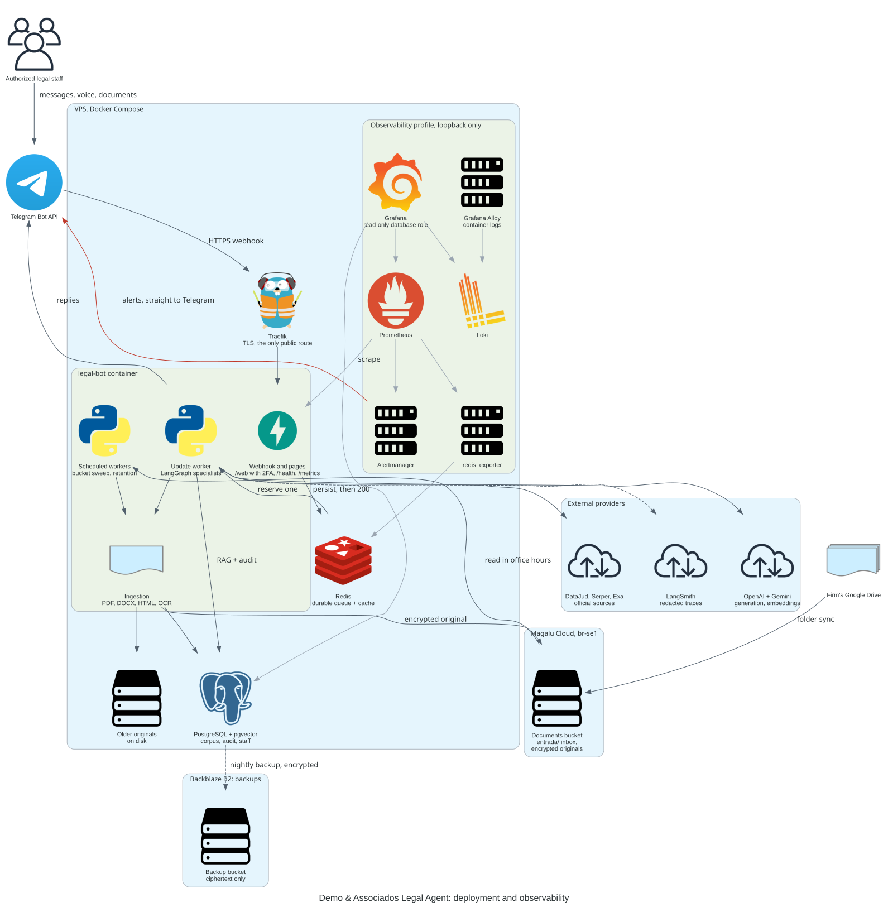

# Architecture

Two views, drawn two different ways on purpose.

**The deployment** is a picture with real icons, [`system.svg`](system.svg),
drawn from [`system.py`](system.py). Nobody pictures this system as a chart of
plain boxes, and the icons are read faster than the labels.

**The agent flow**, [`agent-flow.md`](agent-flow.md), is Mermaid generated from
the compiled LangGraph, so it cannot disagree with the code. CI regenerates it
and fails if the working tree differs.

## Deployment



Three things in that picture are load-bearing and easy to miss.

**The webhook persists before it answers.** Telegram gets its 200 once the
update is durably in Redis, not once the work is done. The worker is a separate
loop reserving one update at a time, so a slow answer never costs a delivery and
a restart never loses one.

**Only the webhook is public.** Traefik routes `/telegram/webhook` and `/health`
and nothing else. Prometheus, Grafana and Alertmanager are bound to loopback and
reached through an SSH tunnel: none of them has authentication worth exposing,
and a login page on the internet is a login page for bots to hammer.

**The alert path does not depend on the application.** Alertmanager talks to
Telegram's servers directly. When the bot is the thing that died, the token
still works, which is exactly when the first alert fires.

And one that arrived with the document intake:

**Documents come in through a bucket, not only through the chat.** The firm's
Google Drive synchronises into the `entrada/` folder of a Magalu Cloud bucket
in `br-se1`, and a scheduled worker reads it during office hours, filing each
document by the folders it sits in. The same bucket holds the originals,
encrypted on the VPS before they leave it; older documents still have theirs
on disk. An ordinary Magalu Cloud key covers the whole account, so the app's
key could reach the inbox and the Drive sync's key the originals; confining
each to one bucket is still to be measured.

**Backups go to a different provider, encrypted.** Each night the database,
the originals and Redis go to Backblaze B2 through an rclone crypt remote, so
B2 only ever holds ciphertext and the key stays on the VPS (and in the firm's
password manager). A second provider is the point: an account at one that is
suspended or wiped still leaves a copy at the other. A weekly drill restores
the newest backup into a throwaway Postgres and checks every original against
its checksum.

## Editing these

```bash
scripts/render_architecture.sh           # redraws system.svg in a throwaway container
python docs/architecture/agent_flow.py   # regenerates agent-flow.md
```

The picture is drawn in Docker and never in CI. The previous version of this
directory installed Graphviz through `apt-get` in CI, and on 2026-09-09 a mirror
served a bad hash and failed a pull request that had nothing to do with
architecture. A drawing tool must not be able to break somebody else's build, so
the renderer lives only in that container and the SVG is committed.

What CI checks instead is the picture's meaning, with nothing installed: every
service in the production compose file has a node in `system.py`, and every node
in `system.py` is in the committed `system.svg`. Adding a service without drawing
it, or changing the drawing without rendering it, fails a test instead of
leaving an old picture that still looks current.
