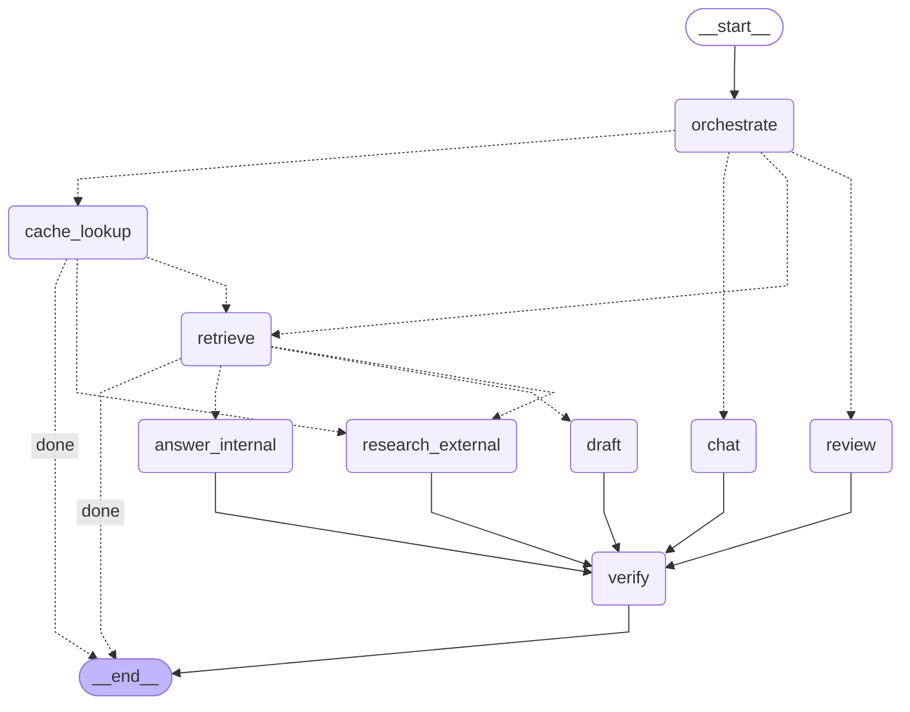

<!--
Generated by docs/architecture/agent_flow.py from the compiled LangGraph.
Do not edit by hand: CI regenerates this file and fails if it differs.
-->

# Agent flow

Every path a message can take through the graph, as compiled. `orchestrate`
routes; `cache_lookup` can end the run on a hit; `retrieve` reads the corpus as
bounded passages; the specialists answer and stop.

